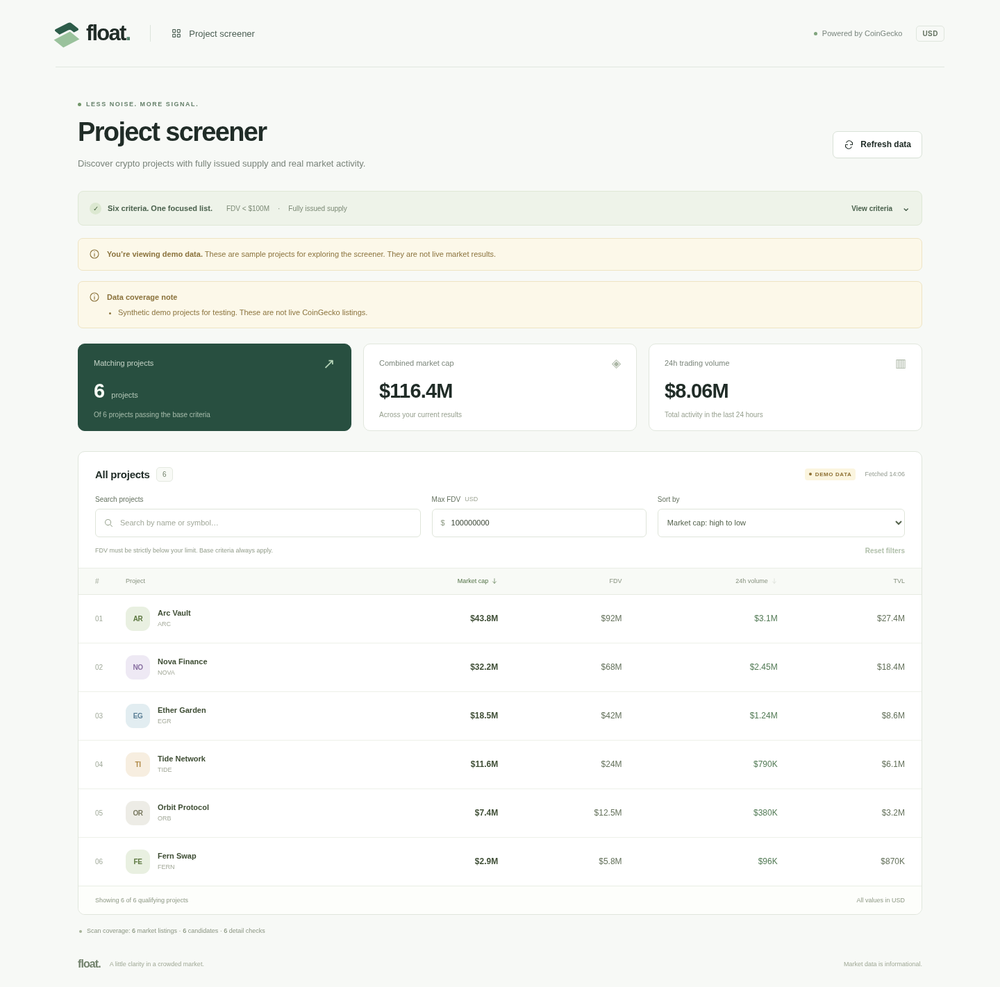

# Spredo · Crypto Screener

A small full-stack application: **Python / FastAPI** fetches and filters CoinGecko data; **React / TypeScript / Vite** displays it. The browser communicates only with the Python API.



## Run locally

Requires Python 3.11+, Node.js 22.12+ (or Node 24 LTS), npm, and optionally [uv](https://docs.astral.sh/uv/).

**1. Backend — terminal one**

```bash
cd backend
cp .env.example .env
uv sync --frozen
uv run uvicorn app.main:app --reload --host 127.0.0.1 --port 8000
```

The default is live CoinGecko data. Set `COINGECKO_API_KEY` in `backend/.env` to your free [Demo API key](https://docs.coingecko.com/demo/reference/authentication). Keys stay on the server. If using a paid key, also set `COINGECKO_API_TIER=pro`.

To explore a populated UI without an API key, set `DATA_MODE=demo` in `backend/.env` before starting the backend. This uses six **synthetic** projects and is visibly labelled in the UI and API. Live failures never fall back to demo data.

Without uv:

```bash
cd backend
python -m venv .venv
source .venv/bin/activate
pip install -r requirements.txt
uvicorn app.main:app --reload --host 127.0.0.1 --port 8000
```

**2. Frontend — terminal two**

```bash
cd frontend
npm ci
npm run dev
```

Open http://localhost:5173. Vite proxies `/api` to Python on port 8000, so no CORS configuration or client-side API key is needed. API documentation: http://127.0.0.1:8000/docs.

**Serve a production build with Python**

```bash
cd frontend
npm ci
npm run build
cd ../backend
uv run uvicorn app.main:app --host 127.0.0.1 --port 8000
```

Open http://127.0.0.1:8000. Build the frontend **before** starting Python; FastAPI mounts `frontend/dist` when the app starts.

## Completed

- REST endpoint `GET /api/projects` returns only projects satisfying all six backend conditions.
- Two-stage retrieval: paginate market data, prefilter candidates, fetch details only for those candidates, then recheck every condition on the detail snapshot.
- Exact supply comparison with `Decimal`; missing, malformed, Boolean, and non-finite numeric values are excluded.
- Five-minute in-memory cache; simultaneous requests share one scan. Upstream calls are sequential, paced, and have a 15-second timeout per call.
- Search by partial project name or symbol, additional strict FDV ceiling, and market cap / 24h volume sorting in both directions.
- Responsive UI with loading, empty, retry, and explicit demo states, plus scan coverage and timestamps.
- Mocked backend integration tests and frontend filter/sort tests; locked dependencies.

## API

```bash
curl http://127.0.0.1:8000/api/health
curl http://127.0.0.1:8000/api/projects
```

`GET /api/projects` returns `{ "projects": [...], "meta": {...} }`.

Each project includes `id`, `name`, `symbol`, `market_cap`, `fdv`, `volume_24h`, `tvl`, `max_supply`, `total_supply`, and `preview_listing`. All monetary values are USD. Metadata includes the data mode, fetch timestamp, cache status, scan counts, truncation flags, and warnings. Upstream errors return an actionable `{ "detail": "..." }` with HTTP 502, 503, or 504; failed scans are not cached or returned as a successful empty list.

## Assumptions and limitations

| Condition | CoinGecko detail field | Rule |
| --- | --- | --- |
| Market capitalization | `market_data.market_cap.usd` | `> 0` |
| Preview listing | `preview_listing` | Boolean `true` only |
| Supply | `market_data.max_supply`, `market_data.total_supply` | Both known, positive, and exactly equal |
| FDV | `market_data.fully_diluted_valuation.usd` | `>= 0` and `< 100,000,000` |
| 24h trading volume | `market_data.total_volume.usd` | `> 50,000` |
| TVL | `market_data.total_value_locked` | `> 50,000`; accepts a USD number or an object containing `usd` |

- [`/coins/markets`](https://docs.coingecko.com/demo/reference/coins-markets) does not include preview status or TVL; those come from [`/coins/{id}`](https://docs.coingecko.com/demo/reference/coins-id). Unknown values fail the filter. Equality is not treated as passing a strict threshold.
- **A valid live result can be empty.** CoinGecko [describes preview listings](https://support.coingecko.com/articles/2654097937-how-to-list-an-upcoming-token-preview-mode) as upcoming tokens. Such projects may have no reported trading activity, market cap, or TVL. The implementation keeps the requested `preview_listing == true` rule.
- **Coverage is bounded, not exhaustive.** By default the backend scans up to four pages of 250 projects, ordered by descending 24h volume, then checks details for at most 25 matching candidates. It stops earlier when the sorted volume reaches the threshold. Both limits are configurable and reported in the UI/API; capped results may omit qualifying projects.
- A cold live scan can take about a minute, or longer on a slow upstream. The default 2.1-second interval is conservative, but shared-IP and monthly [CoinGecko quotas](https://docs.coingecko.com/docs/errors-and-rate-limits) still apply. A rate limit returns 503 without retrying a large batch automatically.
- Cache and request pacing are per Python process; run one worker for this exercise. Restarting loses the cache. The project intentionally has no database, authentication, or background worker.
- Search/filter/sort operate locally over the already filtered response, so typing never causes additional CoinGecko requests. The UI cannot relax the backend's $100M FDV limit.

## Checks

```bash
cd backend
uv sync --frozen
uv run pytest -q
cd ../frontend
npm ci
npm test
npm run build
```

The backend tests mock CoinGecko; they require no key and do not consume API quota. `npm run build` includes TypeScript checking.

Development checks passed: **44 backend tests**, **9 frontend tests**, and the production build. An additional browser smoke check against the Python-served build covered search, strict FDV filtering, all four sort options, empty results, HTTP 503/retry, and a 390px mobile viewport. The browser made no external API requests.

Live verification during development: a real `/coins/markets` request succeeded. A subsequent full scan without a key hit CoinGecko's rate limit, so a complete live scan was not verified in that environment. The backend reports this as an error; use your own Demo API key to check live behavior.

## Structure

```text
backend/
  app/main.py       FastAPI routes and application lifecycle
  app/coingecko.py  Upstream requests, pacing, safe errors
  app/filters.py    Pure normalization and filtering functions
  app/service.py    Scan orchestration and shared response cache
  data/demo.json    Explicit synthetic fixtures
  tests/           Filter and mocked API tests
frontend/
  src/             React UI, typed API contract, view filters and tests
docs/
  AI_WORKFLOW.md    AI usage notes for the submission form
  REVIEW_GUIDE_RU.md  Short explanation for the candidate
```

With more time I would add a persistent snapshot with scheduled refreshes for broader market coverage, retry/backoff respecting `Retry-After`, and a committed browser regression suite. I would also confirm with the task author whether `preview_listing == true` is intentional given its meaning.

AI assisted this implementation; see [workflow notes](docs/AI_WORKFLOW.md).
